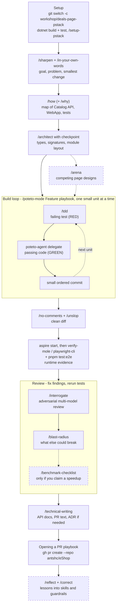

# pstack Workshop — build a feature end to end

The 57 engineering skills in this folder (33 workflow skills and 24 `principle-*` skills) come from [cursor/plugins pstack](https://github.com/cursor/plugins/tree/main/pstack) (see [PSTACK-NOTICE.md](../PSTACK-NOTICE.md)), adapted for GitHub Copilot. Each skill is a `<name>/SKILL.md` that Copilot loads when you type its slash command. The two subagents live in [../agents](../agents): `poteto-agent` (the delegate that `/poteto-mode` spawns) and `comment-sicko` (used by `/no-comments`).

This README is a hands-on workshop: you drive one small feature through the full lifecycle (idea → understand → design → build → clean → verify → review → ship) using the skills, and verify it in the running eShop.

> The workshop uses only the pstack skills. Other folders here (`aspire*`, `dotnet-inspect`, `playwright-cli`, `verify-mole`, ...) are eShop-specific and not part of it, except that Step 6 reuses `verify-mole` and `playwright-cli` to drive the app.

## 1. How to invoke a skill

In Copilot Chat (VS Code or CLI) every skill is a slash command named after its folder:

```text
/poteto-mode  <your prompt>
```

All pstack skills except `/setup-pstack` have `disable-model-invocation: true`, so Copilot never runs them on its own. Type the slash command, or use the fallback that works everywhere: *"Use the poteto-mode skill to …"*. Run `/skills` to confirm they are discovered.

`/poteto-mode` is the main entry point. It matches your task to one of 23 playbooks (in [poteto-mode/playbooks](poteto-mode/playbooks)), copies the playbook's steps into a todo list, and runs the other skills as the steps need them. The other skills are situational: call one directly when you want more or less of it than the playbook gives. Unsure which one fits? Ask `/poteto-help <question>`.

What changed for Copilot (details in each skill, summarized in [poteto-help](poteto-help/SKILL.md)):

| pstack (Cursor) | This repo (Copilot) |
|-----------------|---------------------|
| `Task` subagent with `subagent_type`, `readonly`, `run_in_background` | `task` tool with `agent_type` (`poteto-agent`, `general-purpose`, `explore`) and `mode: "background"` |
| `AskQuestion` | `ask_user` |
| Per-role model slug such as `grok-4.7-xhigh-fast` | `<model> <effort>` pair such as `grok-4.7 xhigh` (`model` + `reasoning_effort`); no fast mode |
| `~/.cursor/rules/pstack-models.mdc` | `.github/instructions/pstack-models.instructions.md` |
| Transcripts in `~/.cursor/projects/<slug>/agent-transcripts/` | `~/.copilot/session-state/<session-id>/events.jsonl` |
| Cursor cloud agents, per-worker cloud VMs | A `git worktree` per worker |
| `cursor-team-kit` `/deslop`, `control-ui`, `control-cli` | `/unslop`, `playwright-cli` or `verify-mole`, a shell |
| `/make-bot-ui` (Cursor Automations) | Not installed |

The Origin and Graphite branches in the PR playbooks only run when an `origin` CLI exists. Otherwise `gh` is used.

The phases and the skills that serve them:

| Phase | Skill (slash command) |
|-------|-----------------------|
| Setup | `/setup-pstack` |
| Clarify | `/sharpen`, `/in-your-own-words` |
| Understand | `/how`, `/why`, `/teach` |
| Design | `/architect`, `/arena`, `/figure-it-out` |
| Build | `/poteto-mode` (Feature playbook), `/tdd` |
| Clean | `/no-comments`, `/unslop`, `/technical-writing` |
| Verify | `verify-mole`, `playwright-cli`, the `principle-prove-it-works` skill |
| Review | `/interrogate`, `/blast-radius`, `/benchmark-checklist` |
| Ship | the Opening a PR playbook, `/show-me-your-work`, `/reflect`, `/correct` |

The principle skills (`principle-model-the-domain`, `principle-prove-it-works`, ...) are one-rule skills that `/poteto-mode` reads and cites. You steer with their names ("apply prove it works, show me the real output"); you rarely type them.

## 2. The workshop feature

**Feature: "Deals page".** A new page for bargain hunters, built as new code next to the existing catalog rather than changing it. It touches three layers — a good size for one sitting (60–90 min):

| Layer | Where | Change |
|-------|-------|--------|
| API | [src/Catalog.API/Apis/CatalogApi.cs](../../src/Catalog.API/Apis/CatalogApi.cs) | New endpoint |
| Web client + UI | [src/WebAppComponents](../../src/WebAppComponents), [src/WebApp](../../src/WebApp) | New client method and page |
| Tests | [tests/Catalog.FunctionalTests](../../tests/Catalog.FunctionalTests), [e2e/](../../e2e) | New test cases/files only |

### Feature description (paste this into the first prompt)

The description is deliberately vague. Do not add detail: pstack does not interview you. `/poteto-mode` restates your goal and the smallest change it expects, and reserves questions for genuine product calls that no experiment can settle. Step 1 is where you see what it assumes and correct it.

```text
I want a "deals" page in the shop where people can quickly find cheap items.
```

Optional stretch goals for later phases: "add a Deals link to the header" (the first change to an existing page, so do it as its own task), "response caching on the endpoint", "add `count` to the OpenAPI doc", "log how often /deals is served".

## 3. Prerequisites

```bash
git remote get-url origin          # expect https://github.com/antshc/eShop(.git)
git switch -c workshop/deals-page-pstack
dotnet build eShop.slnx            # baseline must be green
aspire start                       # needs a container runtime
```

Read first: [ARCHITECTURE.md](../../ARCHITECTURE.md), [GLOSSARY.md](../../GLOSSARY.md), [tests/README.md](../../tests/README.md). Run `dotnet test tests/Catalog.FunctionalTests` once to confirm the baseline passes.

Then run `/setup-pstack` once (optional). It lists the models you can use, asks for a reasoning budget (`unlimited`, `large`, `medium`, `small`), and writes `.github/instructions/pstack-models.instructions.md`, which maps a model to each role. Without it every role keeps its default (`grok-4.7 xhigh` for code, `claude-opus-5.5 xhigh` for prose and judgment). Pick `small` or `medium` for the workshop if you want fewer tokens spent on subagents and review panels. It also offers to generate a verification skill and a formal verification skill; decline both, `verify-mole` already covers the storefront.

## 4. Flow diagram — the skill chain

Top to bottom is the order you run the skills. Each box is a slash command; the text under it is the artifact it produces. Dashed boxes are optional, and the loop in the middle repeats per unit of work.



Your job at each arrow: read the output, correct it, and approve before running the next skill (the restated goal, the architect checkpoint, and every RED → GREEN step are the gates).

## 5. Step-by-step exercises

Each step: **prompt → what to check → output**. Prompts are copy-paste ready.

### Step 1 — Clarify (`/sharpen`, `/in-your-own-words`)

```text
/sharpen I want a "deals" page in the shop where people can quickly find cheap items.
```
`/sharpen` returns a deeper version of the prompt and does not do the task. Edit it, answer anything it asks, then check the agent understood it:
```text
/in-your-own-words <paste your sharpened prompt>
```
**Check:** the restatement names the user (a bargain hunter), the problem, and the smallest change that would meet it (a new endpoint and page, nothing existing modified). It should surface the open questions pstack will not ask for you: what counts as a "deal"? how many items? where does the page live? what when there are none? Decide them yourself and correct the restatement.
**Output:** a confirmed goal and the decisions you made. Paste them into every later prompt.

### Step 2 — Understand (`/how`, `/why`)

```text
/how Map the Catalog API item queries, the WebAppComponents CatalogService client, and the WebApp catalog page.
Read ARCHITECTURE.md, GLOSSARY.md and docs/concepts/ops-error-handling-and-validation.md first.
Where should a deals endpoint and page live?
```
Optionally `/why` on one surprise, such as why prices are stored the way they are.
**Check:** the answer cites real files and symbols, names where new code goes, and says what it did not read. Reject guesses.

### Step 3 — Design (`/architect`, optional `/arena`)

```text
/architect with checkpoint Design the deals feature: endpoint contract (route, `count` parameter, validation),
the client method, and the page component. Name the data shape first.
```
`/architect` sketches types, signatures and module boundaries with `not implemented` bodies, synthesizes several model perspectives, and with `with checkpoint` stops for your sign-off before any code.
**Check:** the sketch matches the Step 1 decisions, reuses the existing result and error shapes, and adds no new project. Push back on the shape now: pushback re-grounds the design.
Optional, for a contested decision such as the UI layout:
```text
/arena Three candidate designs of the /deals page component. Same brief for all, then merge the best parts.
```
**Output:** an approved design sketch.

### Step 4 — Build with `/poteto-mode` and `/tdd`

```text
/poteto-mode Build the approved deals design in small verifiable units: (1) API endpoint returning the cheapest N,
(2) `count` validation with a 400 ProblemDetails, (3) `GetDeals` in the WebAppComponents CatalogService,
(4) the /deals page with an empty state and `?count=`, (5) a Playwright e2e test. Test-first where a cheap test exists.
```
`/poteto-mode` picks the Feature playbook, opens a todo list from its steps, writes a throughput checkpoint, and delegates code to `poteto-agent` subagents. For a unit that needs a regression-style proof first:
```text
/tdd Unit 1: write the failing test first in tests/Catalog.FunctionalTests/CatalogApiTests.cs and show me it fails.
```
**Check each unit:** RED seen → GREEN seen → `dotnet test tests/Catalog.FunctionalTests` green → small ordered commit. Open the todo list and confirm every skipped step says `skip: <reason>`. Delegates run in the background: wait for their reports, then read the diff yourself, not their summary.

### Step 5 — Clean (`/no-comments`, `/unslop`)

```text
/no-comments
```
```text
/unslop Rewrite the PR description draft and any new doc text.
```
**Check:** `/no-comments` spawns `comment-sicko`, which flags narration and workaround comments and marks code that should be reshaped as `MUST KILL`. The repo's own rule applies: comment only a non-obvious *why*.

### Step 6 — Verify in the running app

```bash
aspire start
```
```text
/verify-mole Prove the /deals page shows the 8 cheapest items in ascending price order,
?count=3 shows exactly 3, an invalid count falls back to 8, and the existing Catalog page still works.
```
Use `/playwright-cli` instead if you prefer scripted browser steps. Then run `pnpm test:e2e`.
**Check:** evidence shows the actual prices in order, not just "page loaded"; the browser console is clean. This is the `principle-prove-it-works` rule: verify against the real artifact, not a proxy such as "it compiles".

### Step 7 — Review (`/interrogate`, `/blast-radius`)

```text
/interrogate Review all changes on this branch against main.
```
```text
/blast-radius Which existing callers, routes or tests could the new Catalog API endpoint and page break?
```
`/interrogate` runs adversaries from different model families against the diff. `/blast-radius` looks beyond the diff and proves the one fact that makes the change safe by running real code.
Optionally ask for the performance claim to be vetted, only if you made one:
```text
/benchmark-checklist Vet my measurement of GET /deals against GET /items before I report it.
```
**Check:** every finding is assessed on its merits (fix, dismiss with a concrete reason, or ask), Critical and Important ones are fixed, tests rerun.

### Step 8 — Document and ship

```text
/technical-writing Update the API docs, and add an ADR only if a decision needs recording
(e.g. a hard upper bound of 24 on `count`).
```
```text
/poteto-mode Open the PR for this branch.
```
That runs the Opening a PR playbook: ordered commits, a conventional-commits title, and a body that opens with a `## Why`. It targets this repo; confirm before it pushes:
```bash
git push origin workshop/deals-page-pstack
gh pr create --repo antshc/eShop --base main
```
Never target `dotnet/eShop` (`upstream`).

Optionally close the loop:
```text
/reflect
```
`/reflect` reviews this session's transcript and proposes skill edits you approve. `/correct` finds mistakes agents keep repeating in the repo and makes each impossible (types, a lint, a test) rather than documenting it.

## 6. Done checklist

- [ ] Goal, decisions and design sketch exist and match what was built
- [ ] Every acceptance criterion has a passing test (API + e2e)
- [ ] `dotnet build eShop.slnx` and affected `dotnet test` projects are green
- [ ] Feature verified in the running app with evidence
- [ ] Review findings fixed; no secrets or `artifacts/`/`bin/`/`obj/` committed
- [ ] Docs updated; PR opened against `antshc/eShop`

## 7. Tips

- Start every new task with `/poteto-mode`. The slash command attaches the skill to one message, so it fades as the chat moves on. Say "new task" mid-chat to make it match a fresh playbook.
- Describe the goal and how to tell it is done, not a list of skills. A hand-written sequence tends to drop steps the playbook would keep. `/poteto-help` has prompting steers.
- If the agent goes off-track, `/ketchup` catches you up on the chat, `/bro` restates the last message in plain language, and `/poteto-mode` with "apply attack the premise" makes it test the assumption behind repeated failed fixes.
- Long or unattended run? Use `/figure-it-out`, or ask `/poteto-mode` to "run until done", and have it keep a decision log with `/show-me-your-work`.
- Parallel agents that write files each need their own `git worktree`.
- Skills reference each other by relative path (`../<name>/SKILL.md`); those resolve inside this folder.

## 8. Other feature ideas for repeat runs

| Idea | Layers |
|------|--------|
| Wishlist (save items for later) | Identity, new service or Basket extension, WebApp |
| "Low stock" badge on items | Catalog API, WebApp component |
| Order history CSV export | Ordering API, WebApp |
| Rate limiting on Basket gRPC | Basket.API, ServiceDefaults |
