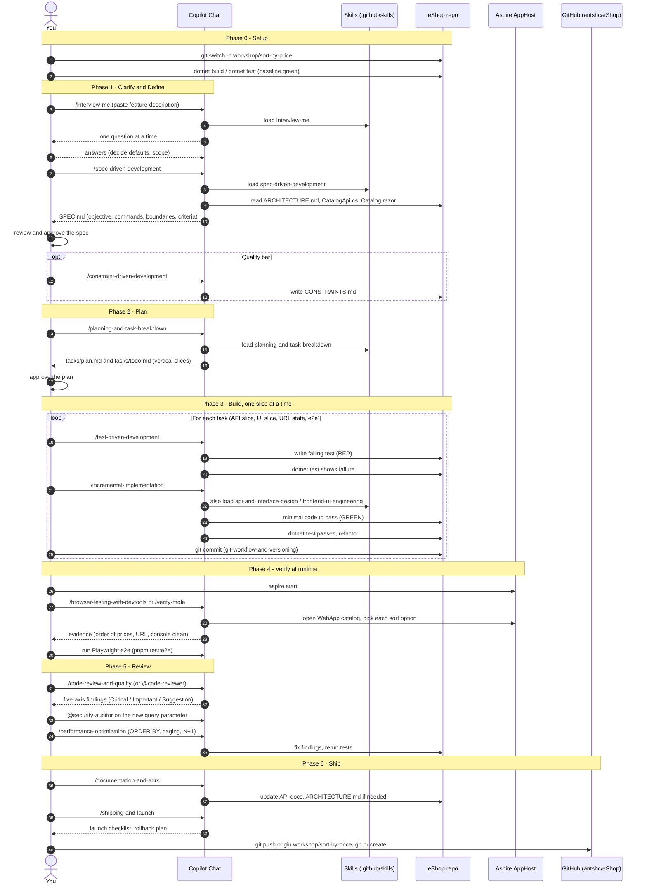

# Agent Skills Workshop — build a feature end to end

The 25 engineering skills in this folder come from [addyosmani/agent-skills](https://github.com/addyosmani/agent-skills) (see [AGENT-SKILLS-NOTICE.md](../AGENT-SKILLS-NOTICE.md)). Each skill is a `<name>/SKILL.md` that Copilot loads on demand. The four personas live in [../agents](../agents) and the shared checklists in [../references](../references).

This README is a hands-on workshop: you drive one small feature through the full lifecycle (idea → spec → plan → build → test → review → ship) using the skills, and verify it in the running eShop.

> The skills in this folder that are not from Osmani (`aspire*`, `dotnet-inspect`, `playwright-cli`, `verify-mole`, `create-verification-skill`, `sssf`) are eShop-specific helpers. The workshop uses a few of them.

## 1. How to invoke a skill

In Copilot Chat (VS Code or CLI) every skill is a slash command named after its folder:

```text
/spec-driven-development  <your prompt>
```

Fallback that works everywhere: *"Use the spec-driven-development skill to …"*. Run `/skills` to confirm they are discovered. Personas are invoked as `@code-reviewer`, `@security-auditor`, `@test-engineer`, `@web-performance-auditor`.

The upstream shortcuts `/spec`, `/plan`, `/build`, `/test`, `/review`, `/ship` are Claude Code only. Use this mapping:

| Phase | Skill (slash command) |
|-------|-----------------------|
| Clarify | `/interview-me`, `/idea-refine` |
| Define | `/spec-driven-development` |
| Quality bar | `/constraint-driven-development` |
| Plan | `/planning-and-task-breakdown` |
| Build | `/incremental-implementation` (+ `/api-and-interface-design`, `/frontend-ui-engineering`) |
| Verify | `/test-driven-development`, `/browser-testing-with-devtools` |
| Review | `/code-review-and-quality`, `/security-and-hardening`, `/performance-optimization` |
| Ship | `/git-workflow-and-versioning`, `/documentation-and-adrs`, `/shipping-and-launch` |

## 2. The workshop feature

**Feature: "Sort catalog by price".** Shoppers can order the catalog list by price (low → high, high → low) or by name. It touches three layers — a good size for one sitting (60–90 min):

| Layer | Where | Change |
|-------|-------|--------|
| API | [src/Catalog.API/Apis/CatalogApi.cs](../../src/Catalog.API/Apis/CatalogApi.cs) (v2 `GET /api/catalog/items`) | Optional `sort` query parameter |
| Web client | [src/WebApp](../../src/WebApp) + [src/WebAppComponents](../../src/WebAppComponents) | Sort dropdown on the Catalog page, state kept in the URL |
| Tests | [tests/Catalog.FunctionalTests](../../tests/Catalog.FunctionalTests), [e2e/](../../e2e) | API tests + one Playwright test |

### Feature description (paste this into the first prompt)

```text
Feature: Sort catalog by price

As a shopper browsing the catalog, I want to order the product list by price
or name so that I can find the cheapest or most expensive items quickly.

Behaviour
- The Catalog page shows a "Sort by" control with: Default, Price: low to high,
  Price: high to low, Name: A–Z.
- Default keeps today's ordering, so existing behaviour does not change.
- The selected sort is kept in the URL (e.g. ?sort=price_asc), survives a page
  refresh, and works together with the existing brand/type filters and paging.
- Changing the sort resets the list to page 1.
- The Catalog API (v2) GET /api/catalog/items accepts an optional `sort`
  parameter: price_asc | price_desc | name_asc. An unknown value returns
  400 with a ProblemDetails body. v1 is unchanged.
- Ties are broken by Id so paging is stable.

Out of scope: sorting search / semantic-relevance results, new database
columns, mobile apps (HybridApp / ClientApp).
```

Optional stretch goals to give to later phases: "sort also applies to `/items/facets` counts" (it should not), "add `sort` to the OpenAPI doc", "log which sort values are used".

## 3. Prerequisites

```bash
git remote get-url origin          # expect https://github.com/antshc/eShop(.git)
git switch -c workshop/sort-by-price
dotnet build eShop.slnx            # baseline must be green
aspire start                       # needs a container runtime; see the aspire skill
```

Read first: [ARCHITECTURE.md](../../ARCHITECTURE.md), [GLOSSARY.md](../../GLOSSARY.md), [tests/README.md](../../tests/README.md). Run `dotnet test tests/Catalog.FunctionalTests` once to confirm the baseline passes.

## 4. Sequence diagram — what you do and what Copilot does



## 5. Step-by-step exercises

Each step: **prompt → what to check → output**. Prompts are copy-paste ready; replace `<FEATURE>` with the description in §2.

### Step 1 — Clarify (`/interview-me`)

```text
/interview-me <FEATURE>
```
Answer the questions one at a time. Good probes: Should `Default` equal today's order? Which sorts are in the first release? What happens to the page number on change?
**Check:** Copilot asks one question at a time and ends with a confirmed summary.

### Step 2 — Specify (`/spec-driven-development`)

```text
/spec-driven-development Write the spec for the confirmed feature. Read
ARCHITECTURE.md, GLOSSARY.md, docs/concepts/ops-error-handling-and-validation.md
and the existing Catalog API first. Save it as docs/plans/sort-by-price-spec.md.
```
**Check:** the spec has objective, commands (`dotnet test tests/Catalog.FunctionalTests`), project structure, testing strategy, boundaries, and testable acceptance criteria. Reject vague criteria like "works well".
**Output:** `docs/plans/sort-by-price-spec.md`. Edit it, then approve.

### Step 3 — Quality bar (optional, `/constraint-driven-development`)

```text
/constraint-driven-development Define constraints for this feature: all new
code covered by tests, no skipped tests, no new warnings, p95 of GET /items
not slower than baseline.
```
**Output:** `CONSTRAINTS.md`. Skills will now flag a weakened bar (skipped tests, suppressions).

### Step 4 — Plan (`/planning-and-task-breakdown`)

```text
/planning-and-task-breakdown Break docs/plans/sort-by-price-spec.md into
vertical slices with acceptance criteria and dependencies. Save to
tasks/plan.md and tasks/todo.md.
```
**Check:** ~4–6 tasks, each shippable on its own, e.g. (1) API `sort` param + validation, (2) tie-break + stable paging, (3) WebApp client passes `sort`, (4) Sort dropdown + URL state, (5) Playwright e2e, (6) docs. No task bigger than ~5 files.

### Step 5 — Build with TDD (`/test-driven-development` + `/incremental-implementation`)

Repeat for each task:

```text
/test-driven-development Task 1 from tasks/todo.md. Write the failing test first
in tests/Catalog.FunctionalTests/CatalogApiTests.cs and show me it fails.
```
```text
/incremental-implementation Implement only task 1 so the test passes. Use
/api-and-interface-design for the parameter contract. Run the tests, then stop.
```
For the UI slice use `/frontend-ui-engineering` (accessible `<select>` with a label, keyboard usable, no layout shift).
**Check each loop:** RED seen → GREEN seen → `dotnet test tests/Catalog.FunctionalTests` green → small commit.
```text
/git-workflow-and-versioning Commit this slice with an atomic message.
```

### Step 6 — Verify in the running app

```bash
aspire start
```
```text
/verify-mole Prove the Catalog page sorts by price low to high and high to low,
the URL contains ?sort=..., a refresh keeps the order, and the brand filter still works.
```
(or `/browser-testing-with-devtools`). Then run `pnpm test:e2e`.
**Check:** evidence shows the actual prices in order, not just "page loaded"; the browser console is clean.

### Step 7 — Review (`/code-review-and-quality`)

```text
/code-review-and-quality Review all changes on this branch against main.
```
Then personas:
```text
@security-auditor Check the new `sort` parameter for injection and error leakage.
@test-engineer Is the test coverage for sorting sufficient? Which edge cases are missing?
```
```text
/performance-optimization Does ORDER BY price use an index? Any extra queries per page load?
```
**Check:** findings are tagged by severity; fix Critical/Important ones, rerun tests.

### Step 8 — Document and ship

```text
/documentation-and-adrs Update API docs and add an ADR only if a decision needs recording
(e.g. whitelist sort keys instead of dynamic ordering).
```
```text
/shipping-and-launch Produce the pre-launch checklist and rollback plan for this change.
```
```bash
git push origin workshop/sort-by-price
gh pr create --repo antshc/eShop --base main
```
Never target `dotnet/eShop` (`upstream`).

## 6. Done checklist

- [ ] Spec, plan and todo exist and match what was built
- [ ] Every acceptance criterion has a passing test (API + e2e)
- [ ] `dotnet build eShop.slnx` and affected `dotnet test` projects are green
- [ ] Feature verified in the running app with evidence
- [ ] Review findings fixed; no secrets or `artifacts/`/`bin/`/`obj/` committed
- [ ] Docs updated; PR opened against `antshc/eShop`

## 7. Tips

- One skill per prompt; let it finish and approve its output before moving on.
- If the agent goes off-track, run `/debugging-and-error-recovery` or `/doubt-driven-development` for a fresh-context challenge of its decision.
- Unsure which skill applies? Ask: *"Use using-agent-skills to pick the next skill for this task."*
- Skills reference shared checklists via `../../references/…`; those resolve to [../references](../references).

## 8. Other feature ideas for repeat runs

| Idea | Layers |
|------|--------|
| Wishlist (save items for later) | Identity, new service or Basket extension, WebApp |
| "Low stock" badge on items | Catalog API, WebApp component |
| Order history CSV export | Ordering API, WebApp |
| Rate limiting on Basket gRPC | Basket.API, ServiceDefaults |
